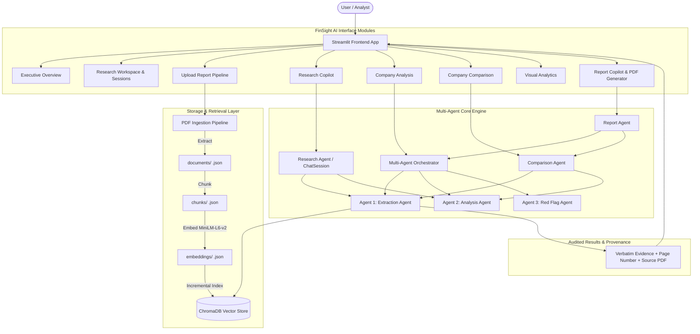

# 📈 FinSight AI — Autonomous Multi-Agent Financial Research & Analytics Platform

[](https://www.python.org/downloads/)
[](https://streamlit.io/)
[](https://www.trychroma.com/)
[](https://huggingface.co/sentence-transformers/all-MiniLM-L6-v2)
[]()
[]()

> **FinSight AI** is a production-grade, institutional financial intelligence platform powered by an autonomous multi-agent architecture and dense vector retrieval over corporate annual reports and 10-K filings. It features zero-hallucination metric extraction, strict page-level source provenance, year-over-year financial audits, rule-based anomaly detection, peer benchmarking, and an interactive conversational research copilot.

---

## 📑 Table of Contents

- [Key Capabilities](#-key-capabilities)
- [System Architecture](#-system-architecture)
- [Multi-Agent Design](#-multi-agent-design)
- [Supported Entities & Financial Metrics](#-supported-entities--financial-metrics)
- [Repository Structure](#-repository-structure)
- [Getting Started](#-getting-started)
  - [Prerequisites](#prerequisites)
  - [Installation](#installation)
  - [Running the Web Application](#running-the-web-application)
- [Data Ingestion Pipeline](#-data-ingestion-pipeline)
- [Verification & Automated Test Suites](#-verification--automated-test-suites)
- [Financial Data Integrity & Provenance](#-financial-data-integrity--provenance)
- [Disclaimer](#-disclaimer)

---

## 🌟 Key Capabilities

### 1. 🔍 Research Copilot (Conversational Financial Intelligence)
- **Natural Language Q&A**: Resolves multi-faceted financial questions with multi-turn conversation memory.
- **Dynamic Entity & Alias Resolution**: Automatically resolves colloquial and ticker symbols (e.g., *"Tata Consultancy Services"* $\to$ `TCS`, *"RIL"* $\to$ `Reliance Industries`, *"MSFT"* $\to$ `Microsoft`).
- **Jurisdictional & Accounting Terminology Alignment**: Maps international accounting synonyms seamlessly (e.g., resolving Indian GAAP/Ind AS *"Profit After Tax"* or *"Profit for the Year"* alongside US GAAP *"Net Income"*).
- **Statement Type Classification**: Differentiates between **Consolidated** and **Standalone** statements directly in extraction and chat findings.
- **Transparent Limitation Reporting**: Gracefully detects unindexed corporations (e.g., *"Nestle"*) or unindexed fiscal years (e.g., *"Apple FY2026"*), actively guiding users with available options.

### 2. 📊 Autonomous Company Analysis Pipeline
- **Sequential Multi-Agent Execution**: Seamlessly orchestrates **Agent 1 (Extraction)** $\to$ **Agent 2 (YoY Analysis)** $\to$ **Agent 3 (Red Flag Screening)**.
- **YoY Variance Calculations**: Computes exact percentage changes for currency/share values and percentage-point variations for margins.
- **Derived Financial Metrics**: Accurately computes derived metrics (e.g., Operating Margin, Net Profit Margin) from ground-truth source figures while maintaining input source links.

### 3. 🚩 Red Flag Screening Engine
- **Auditing Anomaly Detection**: Configurable screening thresholds detect declining revenues, net income drops ($>5\%$), operating margin compression ($>2\text{ pp}$), and rising long-term borrowings ($>15\%$).
- **Divergence Patterns**: Automatically detects and flags warning patterns such as *Revenue Increasing while Net Income Decreases*.
- **Zero Accusatory Language**: Generates strictly objective, descriptive screening flags rather than speculative ratings.

### 4. ⚖️ Peer Comparison & Currency Safety
- **Cross-Company Benchmarking**: Compares multi-enterprise performance side-by-side across common reporting periods.
- **Strict Currency Safety**: Guards against improper cross-currency arithmetic (e.g., prohibits combining USD and INR into invalid ratios or false comparisons).

### 5. 💼 Research Workspace & Named Session Management
- **Named Research Workspaces**: Create, save, switch, and export customized research sessions (e.g., *"Tech Giants FY24 Audit"* or *"Indian IT Peer Benchmarking"*).
- **Persistent Investigation Notes**: Track working financial hypotheses and qualitative analyst observations alongside quantitative metrics.
- **Dossier Archiving**: 1-click export of the complete research session notebook including multi-turn Q&A logs.

### 6. 📈 Visual Analytics & Executive PDF Reports
- **Interactive Visualizations**: Dynamic Altair charts showcasing revenue trajectories, profit margins, and balance sheet compositions.
- **Report Copilot with PDF Generation**: One-click compilation of publication-ready analyst PDF briefings (using ReportLab), complete with Executive Summaries, Audited Key Financials tables, Red Flag Risk Audits, Peer Comparisons, and methodology disclosures.

### 7. 📥 Incremental PDF Ingestion & Document Manager
- **Document Management**: Comprehensive catalog view of all verified filings, page counts, chunk distributions, and ChromaDB vector indexing status.
- **Incremental Pipeline**: Upload new annual report PDFs via the UI with automatic text extraction (`pdfplumber`), semantic chunking with overlap (600 words / 100-word overlap), MiniLM dense vector generation, and incremental indexing into ChromaDB without resetting existing data.

---

## 🏗️ System Architecture



---

## 🤖 Multi-Agent Design

| Agent | Responsibility | Core Principles |
| :--- | :--- | :--- |
| **Agent 1: Extraction Agent** (`extraction_agent.py`) | Vector search over annual report chunks; extraction of financial rows; scale/currency normalization. | **Dual-pass retrieval**, table header year verification, exact row candidate scoring, and zero estimation. |
| **Agent 2: Analysis Agent** (`analysis_agent.py`) | Year-over-year variances, percentage point differences for margins, and derived ratios. | **Deterministic arithmetic**, currency compatibility checks (USD vs INR isolation), no extrapolation. |
| **Agent 3: Red Flag Agent** (`red_flag_agent.py`) | Rule-based screening for corporate performance anomalies. | **Descriptive screening only**; requires threshold violations; never invents findings when data is missing. |
| **Multi-Agent Orchestrator** (`multi_agent_orchestrator.py`) | End-to-end sequential pipeline coordination (Agent 1 $\to$ Agent 2 $\to$ Agent 3). | Enforces strict data contracts, validates output schemas, and handles partial data safely. |
| **Research Agent** (`research_agent.py`) | Natural language understanding, query decomposition, and conversational context tracking. | Dissect compound questions, ground answers in indexed catalog, and surface limitation warnings. |
| **Comparison Agent** (`comparison_agent.py`) | Peer entity comparison and company catalog management. | Enforces currency and metric comparability; handles entity aliases. |
| **Report Agent** (`report_agent.py`) | Institutional executive briefing synthesis. | Generates structured markdown summaries with audit trails and full document citations. |

---

## 📊 Supported Entities & Financial Metrics

### Currently Indexed Corporates (4,995+ Chunks)
- 🍏 **Apple Inc.** (FY2022 – FY2024)
- 💻 **Microsoft Corporation** (FY2023 – FY2025)
- 📦 **Amazon.com, Inc.** (FY2023 – FY2025)
- ⚡ **Tesla, Inc.** (FY2024 – FY2025)
- ⛽ **Reliance Industries Limited** (FY2023 – FY2025)
- 🏢 **Tata Consultancy Services (TCS)** (FY2023 – FY2025)
- 🌐 **Infosys Limited** (FY2022, FY2024)

### Supported Financial Metrics
- **Income Statement**: Revenue / Revenue from Operations, Total Income, Gross Profit, Operating Income, Profit Before Tax (PBT), Profit After Tax (PAT) / Net Income, Diluted & Basic Earnings Per Share (EPS).
- **Margins**: Gross Margin (%), Operating Margin (%), Net Profit Margin (%).
- **Balance Sheet**: Total Assets, Total Liabilities, Total Equity / Shareholders' Equity, Cash and Cash Equivalents, Total Debt & Borrowings.
- **Cash Flows**: Cash Flow from Operating Activities, Cash Flow from Investing Activities, Cash Flow from Financing Activities.

---

## 📁 Repository Structure

```text
FinSight-AI/
├── app.py                         # Streamlit interactive application (Production Frontend)
├── config.py                      # Central settings, paths, and chunking parameters
├── run_app.bat                    # One-click Windows launch script
│
├── extraction_agent.py            # Agent 1: Vector search, regex parsing, scale/unit normalizer
├── analysis_agent.py              # Agent 2: YoY variance, margin analysis, derived metrics
├── red_flag_agent.py              # Agent 3: Configurable financial anomaly screening
├── multi_agent_orchestrator.py    # Pipeline coordinator connecting Agents 1 -> 2 -> 3
├── research_agent.py              # Conversational NLP research agent & question decomposer
├── comparison_agent.py            # Cross-company benchmarking & catalog management
├── report_agent.py                # Executive briefing & institutional report builder
├── chat_interface.py              # Multi-turn chat session controller & UI formatting
├── models.py                      # Dataclasses & shared data models
│
├── extract_pdf_text.py            # PDF text extraction utility (pdfplumber)
├── chunk_documents.py             # Word-count-based semantic chunker (600 words, 100 overlap)
├── generate_embeddings.py         # Dense vector embedding generator (all-MiniLM-L6-v2)
├── index_chromadb.py              # ChromaDB vector indexing pipeline
│
├── data/
│   └── annual_reports/            # Raw corporate annual reports (PDFs)
├── documents/                     # Structured page-by-page JSON extractions
├── chunks/                        # Text chunks with page metadata
├── embeddings/                    # Vector embedding records
├── vectordb/                      # ChromaDB SQLite storage (4,995 indexed chunks)
│
└── tests/
    ├── test_research_retrieval_suite.py # 31-test suite for Research Copilot retrieval & parity
    ├── final_backend_verification.py    # 103 real-data tests & multi-agent integration checks
    ├── test_extraction_agent.py         # Unit & candidate extraction tests (38 checks)
    ├── test_analysis_agent.py           # YoY variance & currency safety tests (7 checks)
    ├── test_red_flag_agent.py           # Financial anomaly screening tests (9 checks)
    └── test_multi_agent_validation.py   # Multi-agent handoff & integrity tests (21 checks)
```

---

## 🚀 Getting Started

### Prerequisites
- **Python**: Version `3.10` or higher (`3.11` / `3.12` / `3.13` supported).
- **Hardware**: Standard CPU (PyTorch running CPU inference for `all-MiniLM-L6-v2`).

### Installation

1. **Clone the Repository**:
   ```bash
   git clone https://github.com/your-username/finsight-ai.git
   cd finsight-ai
   ```

2. **Create and Activate a Virtual Environment**:
   ```bash
   # Windows
   python -m venv .venv
   .venv\Scripts\activate

   # Linux / macOS
   python3 -m venv .venv
   source .venv/bin/activate
   ```

3. **Install Dependencies**:
   ```bash
   pip install streamlit chromadb sentence-transformers torch pdfplumber pandas altair pydantic
   ```

### Running the Web Application

Launch the Streamlit web application:

```bash
streamlit run app.py
```

Or on Windows, simply double-click:
```cmd
run_app.bat
```

The application will be accessible at `http://localhost:8501`.

---

## 🔄 Data Ingestion Pipeline

To ingest a new annual report from the command line:

```bash
# 1. Place your PDF inside data/annual_reports/
# 2. Extract page-by-page text
python extract_pdf_text.py

# 3. Generate semantic chunks
python chunk_documents.py

# 4. Generate dense embeddings
python generate_embeddings.py

# 5. Index into ChromaDB
python index_chromadb.py
```

*Alternatively, navigate to the **Upload Report** page directly within the Streamlit UI to execute this workflow with an interactive progress monitor.*

---

## 🧪 Verification & Automated Test Suites

FinSight AI includes comprehensive automated regression suites verifying financial correctness, source citations, and zero-hallucination guardrails:

```bash
# Run the complete Research Copilot Retrieval Suite (31 checks covering Parity, Aliases, Concepts)
python test_research_retrieval_suite.py

# Run Full Backend & Multi-Agent Verification (103 real-data tests across the entire pipeline)
python final_backend_verification.py

# Run individual agent verification suites
python test_extraction_agent.py
python test_analysis_agent.py
python test_red_flag_agent.py
python test_multi_agent_validation.py
```

### Test Coverage Highlights
- ✅ **Parity Guarantee**: Proves Research Copilot retrieves identical metric values to Visual Analytics.
- ✅ **Provenance Check**: Validates that cited page numbers and verbatim snippets match indexed PDFs.
- ✅ **Currency Safety**: Confirms cross-currency operations (e.g., USD vs INR) are rejected with explanatory notices.
- ✅ **Anomaly Safeguards**: Confirms red flags trigger on real financial thresholds and never on missing data.

---

## 🛡️ Financial Data Integrity & Provenance

FinSight AI was engineered to solve the hallucination problem inherent in standard generative AI systems applied to corporate finance:

1. **Zero Extrapolation**: Numerical figures are never predicted or estimated by an LLM; they are retrieved from statement tables and validated against column headers.
2. **Transparent Provenance**: Every metric card and research response cites the exact **Source Document**, **Page Number**, and **Verbatim Context**.
3. **Audit Trail**: Any computed figure (e.g., Operating Margin or YoY % change) is explicitly badged as `[DERIVED]`, linking back to its raw `[REPORTED]` inputs.

---

## ⚠️ Disclaimer

*FinSight AI is an automated financial research and document analysis assistant intended for informational and academic purposes only. It does not provide investment advice, financial planning, or tax recommendations. Always cross-reference extracted metrics with certified annual reports and regulatory filings before making investment decisions.*
